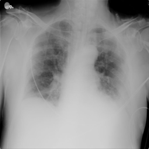
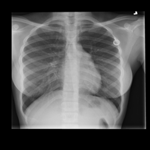
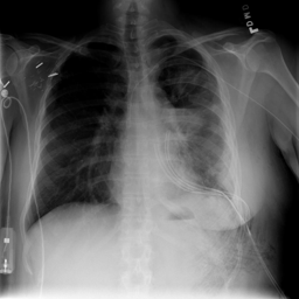
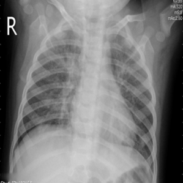
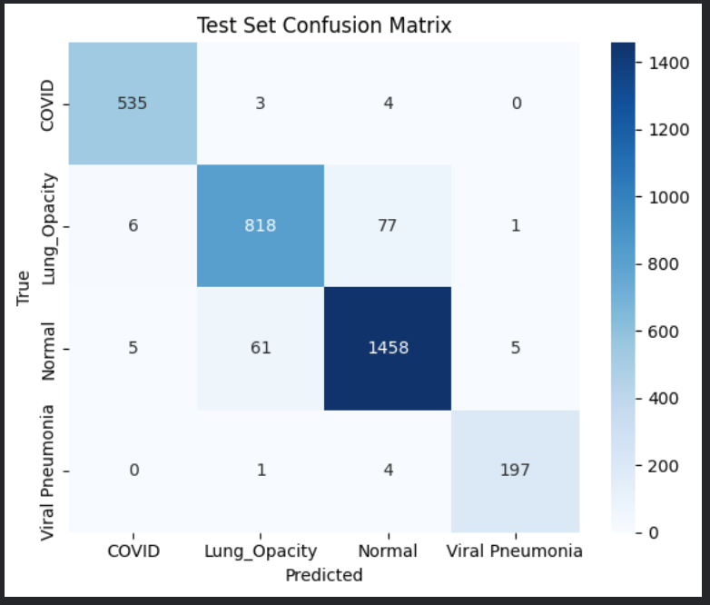
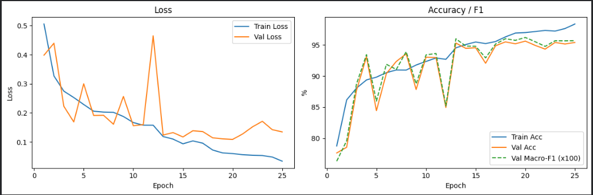
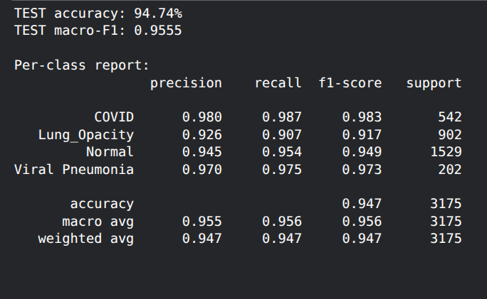

<p align="center">
  
</p>

<p align="center"><b>Chest X-Ray Classification &nbsp;|&nbsp; ResNet-18 &nbsp;|&nbsp; Grad-CAM &nbsp;|&nbsp; 3D Lung Visualization &nbsp;|&nbsp; FastAPI</b></p>

<p align="center">
  <a href="https://github.com/wajidcodes/Detecting-COVID-19-with-Chest-X-Ray-using-PyTorch">Repository</a>
</p>

<div align="center">

[](https://python.org)
[](https://pytorch.org)
[](https://fastapi.tiangolo.com)
[](https://threejs.org)
[](LICENSE)

**94.74% test accuracy · 95.55% macro F1 · 4 classes**

</div>

**PulmoScan AI** is a full-stack deep learning web application that classifies chest X-ray images into 4 categories using a trained ResNet-18 model — with Grad-CAM heatmaps that show exactly which lung regions the AI focused on, and an interactive 3D lung visualization that maps that attention onto the lung.

Upload any chest X-ray PNG/JPG and get a classification prediction in seconds.

> **Learning only, not a diagnosis:** this software is for research and educational purposes only. It is not intended for clinical diagnosis, medical advice, or treatment decisions. Always consult a qualified healthcare professional. COVID-19 must be confirmed with RT-PCR or equivalent tests.

---

## What it can spot

| COVID-19 | Normal | Lung Opacity | Viral Pneumonia |
| --- | --- | --- | --- |
|  |  |  |  |

Four classes, one model — ResNet-18 fine-tuned on the COVID-19 Radiography Database.

---

## Results

> Trained on the **COVID-19 Radiography Database v2** (Chowdhury / Rahman, 2020).
>
> Trained on Kaggle T4x2 GPU with class-weighted loss, learning rate scheduling, and early stopping by macro-F1.

| Metric | Score |
|---|---|
| **Test Accuracy** | **94.74%** |
| **Macro F1-Score** | **95.55%** |
| Epochs | 25 |
| Train / Val / Test Split | 70 / 15 / 15 (stratified, seed = 42) |
| Class Weighting | Inverse-frequency (handles imbalance) |
| Training Time | ~1 hour on Kaggle T4x2 GPU |

### Per-class results (test set, 3,175 images)

| Class | Precision | Recall | F1 | Support |
|---|---|---|---|---|
| **COVID-19** | 98.0% | 98.7% | **98.3%** | 542 |
| **Normal** | 94.5% | 95.4% | **94.9%** | 1,529 |
| **Lung Opacity** | 92.6% | 90.7% | **91.7%** | 902 |
| **Viral Pneumonia** | 97.0% | 97.5% | **97.3%** | 202 |

### Training artifacts

| Confusion Matrix | Training Curves |
| --- | --- |
|  |  |



All test metrics are also machine-readable in [`artifacts/metrics.json`](artifacts/metrics.json).

---

## What makes it different

- **Grad-CAM heatmap overlay** — shows exactly which lung regions the AI focused on (not thresholding — actual gradient-weighted class activation maps, Selvaraju et al., ICCV 2017)
- **3D interactive lung visualization** (Three.js) — highlights infected zones based on Grad-CAM attention, built entirely in the browser, no external 3D files needed
- **FastAPI backend** — real-time inference with the trained model, `/predict` REST endpoint, API docs at `/docs`
- **One-command start** — `bash start.sh` runs the FastAPI backend and serves the UI
- **Trained weights included** — `backend/resnet18_covid_best.pth` is in the repo and loads automatically, so inference works out of the box

---

## How the 3D visualization works

The 3D lung model is built with **Three.js** entirely in the browser — no external 3D files needed.

When you analyze an X-ray:
1. The backend runs **Grad-CAM** on `layer4` (last ResNet-18 conv block)
2. The resulting heatmap is divided into 4 zones: upper-left, lower-left, upper-right, lower-right
3. Each zone's average attention score is sent back to the frontend
4. Three.js renders glowing blobs on the 3D lung model at the corresponding zones
5. **Blue** = healthy / low attention · **Orange** = moderate · **Red** = high AI attention

This provides a fully interactive, in-browser 3D visualization to help understand the AI's prediction focus. The Grad-CAM zones mapped onto the 3D lung illustration are AI attention approximations projected from 2D heatmaps, not CT-derived 3D segmentation.

---

## Architecture & tech stack

```
┌─────────────────────────────────────────────────────┐
│  Frontend (served by FastAPI)                       │
│  ├── Three.js    →  3D Interactive Lung Model       │
│  ├── Vanilla JS  →  Upload, Results, API calls      │
│  └── Pure CSS    →  Dark medical UI design          │
├─────────────────────────────────────────────────────┤
│  Backend (FastAPI + PyTorch)                        │
│  ├── ResNet-18   →  4-class classification          │
│  ├── Grad-CAM    →  Lung zone attention heatmaps    │
│  └── /predict    →  REST API endpoint               │
├─────────────────────────────────────────────────────┤
│  start.sh → Runs the FastAPI backend (serves UI)    │
└─────────────────────────────────────────────────────┘
```

**Why ResNet-18?**
Standard, well-understood architecture with ImageNet pre-training. Achieves 94.7% accuracy at low computational cost — solid baseline before further optimization.

**Why Grad-CAM?**
Selvaraju et al. (ICCV 2017) — gradient-weighted class activation mapping. Shows *which pixels* influence the prediction, without any post-hoc thresholding. The heatmap zones are then mapped onto the 3D lung model for an intuitive visual explanation.

**Why class-weighted loss?**
The dataset has 10,192 Normal vs only 1,345 Viral Pneumonia images (7.6× imbalance). Without weighting, the model would learn to guess "Normal" most of the time. Inverse-frequency weighting (Buda et al., Neural Networks 2018) corrects this.

---

## Project structure

```
Detecting-COVID-19-with-Chest-X-Ray-using-PyTorch/
├── start.sh                   # One-command start (FastAPI on 127.0.0.1:8000)
├── requirements.txt           # Training dependencies (torch, scikit-learn, ...)
├── train.py                   # Local training script
│
├── backend/
│   ├── main.py                # FastAPI inference API with Grad-CAM
│   ├── requirements.txt       # Backend dependencies (FastAPI, uvicorn, torch)
│   └── resnet18_covid_best.pth # Trained weights (included, loaded automatically)
│
├── frontend/
│   ├── index.html             # Full UI (Three.js 3D lung + results)
│   ├── script.js              # Upload, results, API calls
│   ├── style.css              # Dark medical UI design
│   ├── training.html          # Training results page
│   ├── artifacts/             # Training result images (shown in UI)
│   └── samples/               # Sample X-ray images
│
├── src/
│   ├── model.py               # ResNet-18 definition
│   ├── dataset.py             # Dataset & transforms
│   └── gradcam.py             # Grad-CAM implementation
│
├── notebooks/
│   └── train_resnet18.ipynb   # Kaggle/Colab training notebook
│
├── sample_images/             # Sample X-rays for quick testing
│
└── artifacts/
    ├── Confusion_Matrix.png
    ├── Training_Curves.png
    ├── per_class_report.png
    └── metrics.json           # All test metrics (machine-readable)
```

---

## Quick start — run locally

**Prerequisites:** Python 3.10 and pip installed.

```bash
# 1. Clone the repository
git clone https://github.com/wajidcodes/Detecting-COVID-19-with-Chest-X-Ray-using-PyTorch.git
cd Detecting-COVID-19-with-Chest-X-Ray-using-PyTorch

# 2. Install the backend dependencies
pip install -r backend/requirements.txt

# 3. Run (activates .venv if one exists)
bash start.sh

# 4. Open in browser
# Web UI:   http://127.0.0.1:8000
# API Docs: http://127.0.0.1:8000/docs
```

Note on model weights: the trained weights (`backend/resnet18_covid_best.pth`) are included in this repository, so inference works out of the box. To use your own retrained weights instead, replace that file with yours — the backend loads it first. Upload any chest X-ray PNG/JPG to get a classification prediction — for learning purposes only, not a diagnosis.

---

## Re-training the model (cloud GPU)

### On Kaggle (free T4x2 GPU — ~1 hour)

1. Go to [kaggle.com](https://www.kaggle.com) → **Create → New Notebook**
2. **File → Import Notebook** → upload `notebooks/train_resnet18.ipynb`
3. **Add Data** → search `COVID-19 Radiography Database` (v2 dataset, already on Kaggle, no upload needed)
4. **Session options → Accelerator → GPU T4x2**
5. Update `data_dir` in Cell 3:
   ```python
   data_dir = '/kaggle/input/covid19-radiography-database/COVID-19_Radiography_Dataset'
   ```
6. **Run All** — takes approximately **~1 hour** on T4x2
7. Download `resnet18_covid_best.pth` → replace the bundled `backend/resnet18_covid_best.pth` with it (the backend loads that file first)

### Retraining locally

`train.py` expects the dataset under `data/` in the repo root, with a `data/splits.csv` file listing the train / val / test split:

```
data/
├── COVID/            # COVID-19 X-rays
├── Normal/           # Normal X-rays
├── Lung_Opacity/     # Lung Opacity X-rays
├── Viral Pneumonia/  # Viral Pneumonia X-rays
└── splits.csv        # image path, class, split (train/val/test)
```

The dataset itself is **not** in the repo — download the COVID-19 Radiography Database (v2) from Kaggle and lay it out as above, then run `train.py`.

---

## Medical disclaimer

This software is for **research and educational purposes only**. It is **not** intended for clinical diagnosis, medical advice, or treatment decisions. Always consult a qualified healthcare professional. COVID-19 must be confirmed with RT-PCR or equivalent tests.

The Grad-CAM zones mapped onto the 3D lung illustration are AI attention approximations projected from 2D heatmaps, not CT-derived 3D segmentation.

---

## References

1. He et al. (2016). Deep Residual Learning for Image Recognition. CVPR 2016.
2. Selvaraju et al. (2017). Grad-CAM. ICCV 2017. DOI: 10.1109/ICCV.2017.74
3. Chowdhury et al. (2020). Can AI help in screening viral and COVID-19 pneumonia? IEEE Access 8.
4. Buda et al. (2018). A systematic study of the class imbalance problem. Neural Networks 106.
5. Deng et al. (2009). ImageNet: A large-scale hierarchical image database. CVPR 2009.

---

<div align="center">

Made with ❤️ by **[Wajid Ali](https://github.com/wajidcodes)**

[GitHub](https://github.com/wajidcodes) · [LinkedIn](https://www.linkedin.com/in/wajid-ali-developer/) · [Portfolio](https://wajidali-portfolio.vercel.app)

</div>
